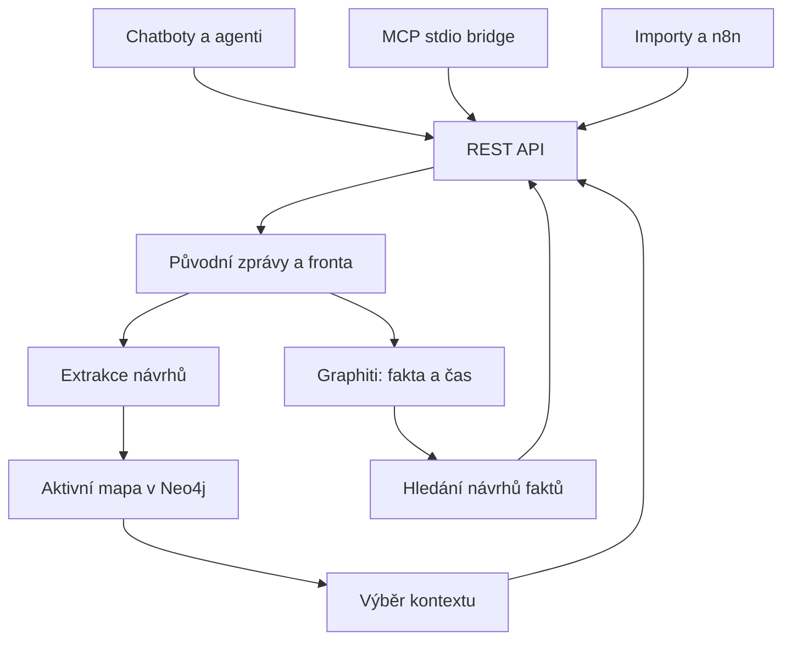

# Architektura

## Hranice produktu

Active Memory vlastní zdroje, veřejný kontrakt, oprávnění, interpretace, schvalování,
aktivní mapu a sestavení kontextu. Nezávisí na agentovi, který s uživatelem právě mluví.
Agent je mozek konkrétní interakce; n8n může být auditovaná integrační/orchestrační vrstva.
Paměť nevyžaduje ani jeden z nich.

MCP bridge je lokální proces u klienta a používá stejné HTTP oprávnění jako REST.
Graphiti SDK běží uvnitř paměťové služby; neprovozujeme cizí REST image s neověřeným kontraktem.

## Implementovaný tok

1. Ověření bearer tokenu a práva write.
2. Pydantic validace + kontrola citací + minimální detekce známých credential patternů.
3. Atomické uložení raw epizody a queue jobu. Odpověď 202 neznamená hotovou indexaci.
4. Jeden embedded worker vyzvedne job, s lease 30 minut a nejvýše třemi pokusy.
5. Dodané návrhy nebo volitelná LLM extrakce. Automaticky se extrahuje jen user role.
6. Volitelná Graphiti projekce user zprávy do časového grafu.
7. Kandidáti do aktivního grafu, ABOUT vazby k tématům, četnost a aktivita.
8. Job done. Chyba ukládá pouze název třídy, bez upstream obsahu. Failed lze ručně retry.
9. Owner schválí/odmítne uzly a zvlášť vazby. Kontext defaultně jen confirmed.

## Úložiště

| Vrstva | Úložiště | Role |
|---|---|---|
| Původní zdroje | SQLite journal | přesný text, role, externí ID, datum, dodané návrhy |
| Provoz | SQLite journal | idempotence, durable jobs, audit akcí |
| Aktivní mapa | Neo4j `AMNode` + typed labels/relationships | myšlenky/témata/cíle/otázky/rozhodnutí a citace |
| Fakta, entity, vektory | Graphiti v Neo4j | extrakce entit a časových faktů, hybrid retrieval |
| Lokální ověřovací adapter | atomický JSON snapshot | stejné active-map operace bez grafového serveru |

Neo4j aktivní mapa je nyní držena v paměti procesu a ukládá se transakčním snapshotem.
To zjednodušuje první osobní instanci, ale je O(N) při zápisu a neumožňuje další writer proces.
Před většími importy implementovat AM-006: incremental updates, query-side pagination, provider jobs.
Graphiti má vlastní labels a `group_id`; naše mapa používá `AMNode` a `scope`.
Zdrojové epizody mají deterministické UUIDv5; stejné UUID dostává Graphiti.
Graphiti 0.30.2 vyžaduje group_id bez dvojteček; adapter mapuje scope na `am_` + SHA-256 prefix.
Při dodaném UUID SDK aktualizuje existující episode, proto adapter nejprve vytvoří EpisodicNode
s tímto UUID. Oba detaily mají SDK contract test.

## Nezávislost a bezpečná hranice

Scope se vybírá na serveru při startu. Klient ho nemůže přepsat ani poslat cizí `group_ids`.
Změna owner scope nad stejným journal adresářem je odmítnuta. Jedna nasazená instance = jeden
osobní prostor, všichni klienti s read vidí celý tento prostor. Nejde o multi-tenant SaaS.

Bearer klíče jsou v configu jako SHA-256 hash, ověřují se constant-time porovnáním.
Práva read/write/admin jsou samostatná. Výchozí owner fallback v Coolify je pouze pro první
private instalaci; pro agenty doplnit oddělené read/write klíče.
OIDC/IAM bude implementováno za stejným principal/authorization kontraktem, bez změny modelu.

Zdroje jsou lokální; zapnutí modelu může posílat text LLM providerovi. Graphiti embeddings a
LLM mají samostatné URL/klíče. Konfigurace sama nezaručuje funkčnost všech kompatibilních modelů.
Služba nic automaticky nepřipojuje k účtům ChatGPT, Claude, Gemini ani k firemním systémům.

## Evoluce

Extrakce → kandidáti významu → návrhy podobnosti/aliases → řízená konsolidace → osobní mapa → kontext.
Automatické recurring theme labels dnes sjednotí jen totožný normalizovaný label; sémantické
parafráze a latentní témata jsou explicitní další milestone. Nepřidávat stovky typů před evaly.
Konektory nesmějí interpretovat raw chain-of-thought jako paměť.
